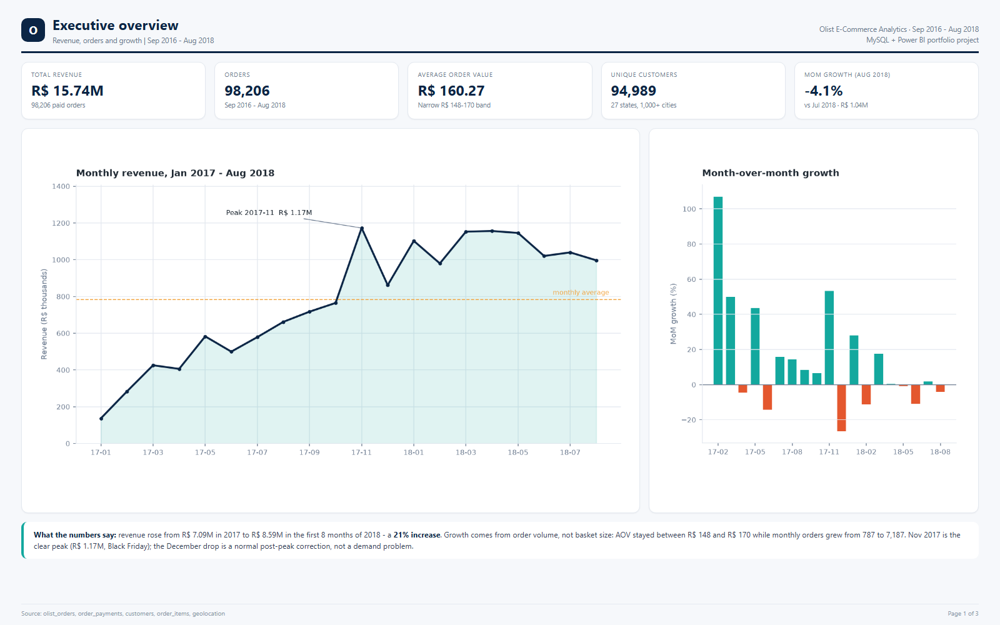
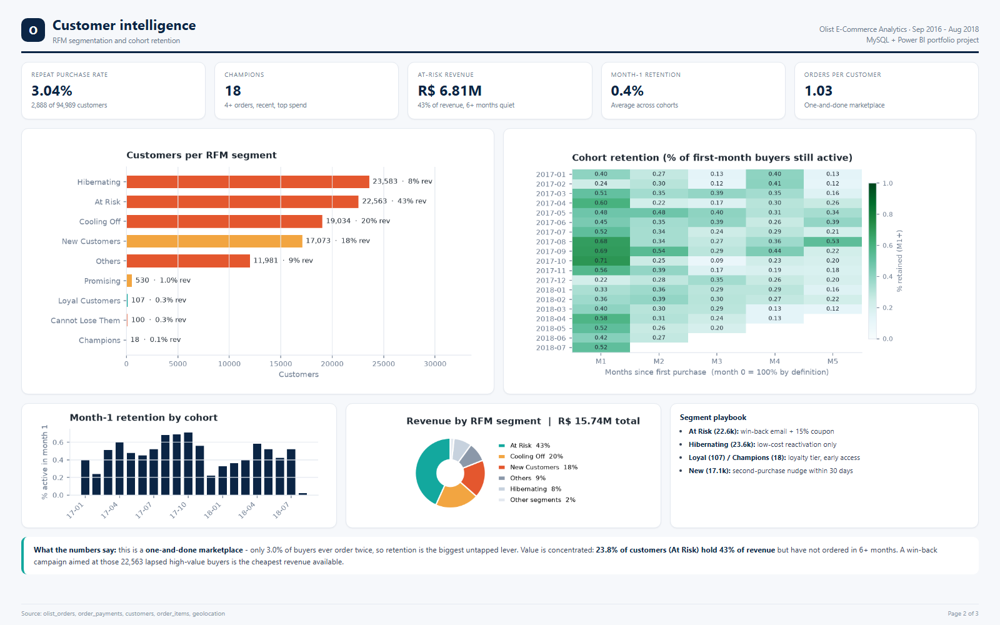
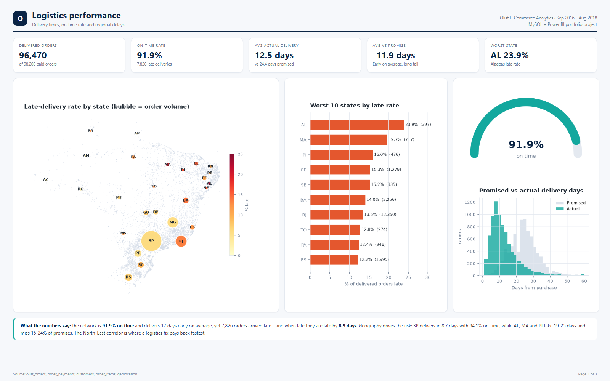

# E-Commerce Analytics: SQL + Power BI

End-to-end analysis of the **Olist Brazilian e-commerce dataset** (99,441 orders,
Sep 2016 - Aug 2018): raw CSVs → MySQL database → SQL analysis → three-page
executive dashboard.

The project root is `D:\Analyst project 1` (raw CSVs stay in `D:\Analyst project 1\Dataset`).

The project answers three business questions:

| Question | Script | Dashboard page |
| --- | --- | --- |
| Are monthly sales growing or dropping? | `sql/10_revenue_by_month.sql` | Executive |
| Who are the best buyers, and how many come back? | `sql/20_rfm_segmentation.sql`, `sql/30_cohort_retention.sql` | Customers |
| Are packages on time, and which regions are late? | `sql/40_logistics_delivery.sql` | Logistics |







A single PDF of all three pages: `dashboard/Olist_Dashboard.pdf`.

---

## Headline findings

**Sales**

- Revenue **R$ 15.74M** across **98,206 paid orders**, average order value **R$ 160.27**.
- 2017: R$ 7.09M. Jan-Aug 2018 alone: R$ 8.59M (**+21%** on a full 12 months).
- Growth is volume-driven: monthly orders went from 787 (Jan 2017) to 7,187 (Jan 2018)
  while AOV stayed inside a narrow R$ 148-170 band.
- Nov 2017 is the peak month (R$ 1.17M, Black Friday). Dec 2017 (-26.5% MoM) is the
  normal post-peak correction, not a demand collapse.

**Customers**

- Repeat purchase rate is **3.04%** (2,888 of 94,989 buyers); 1.03 orders per customer.
  This is a one-and-done marketplace, so retention is the cheapest growth lever.
- **23.8% of customers (22,563 "At Risk") hold 43% of all revenue** (R$ 6.81M) and have
  not ordered in 6+ months. A win-back campaign is worth more than new acquisition.
- Only 18 customers qualify as Champions (recent, 4+ orders, top spend) and 107 as
  Loyal: the top of the pyramid is almost empty.
- Cohort retention: ~0.4% of a cohort orders again in month 1, ~0.2-0.3% in later
  months. There is no habit loop to protect - there is one to build.

**Logistics**

- 96,470 delivered orders, **91.89% on time**, 7,826 late.
- Average delivery is **12.5 days against a 24.4-day promise** (11.9 days early), but
  when an order is late it is late by **8.9 days** - the promise is generous, the tail
  is expensive.
- Geography is the driver: SP 8.7 days / 5.9% late, RJ 15.2 days / 13.5% late,
  AL 24.5 days / **23.9% late**, MA 19.7%, PI 16.0%, CE 15.3%.
  The North-East corridor is where a logistics fix pays back fastest.

---

## Repository layout

```
ecommerce-sql-powerbi/
├── sql/
│   ├── 00_create_database.sql      # database + 9 raw tables
│   ├── 01_load_data.sql            # LOAD DATA LOCAL INFILE for all CSVs
│   ├── 10_revenue_by_month.sql     # revenue, AOV, MoM/YoY (LAG), KPIs
│   ├── 20_rfm_segmentation.sql     # R/F/M scoring, 9 segments, win-back list
│   ├── 30_cohort_retention.sql     # cohort table, retention matrix (LEAD/LAG)
│   ├── 40_logistics_delivery.sql   # delivery fact table, late rates by state
│   ├── 50_views_for_bi.sql         # vw_* views consumed by the dashboard
│   ├── prep_reviews.py             # cleans embedded newlines in review comments
│   ├── export_views.py             # exports every view to CSV
│   └── run_all.ps1                 # rebuild everything end to end
├── dashboard/
│   ├── build_dashboard.py          # renders the 3 pages (matplotlib + HTML)
│   ├── page1.html ... page3.html   # self-contained pages
│   ├── screenshots/page1-3.png     # images used above and in the PDF
│   ├── Olist_Dashboard.pdf         # 3-page report
│   └── assets/                     # individual charts
├── docs/POWERBI_GUIDE.md           # click-by-click Power BI rebuild + DAX
├── exports/                        # CSV snapshots of every view + SQL outputs
└── tools/                          # portable database server + start/stop scripts
```

---

## How to run it

### 1. Start the database

```powershell
powershell -ExecutionPolicy Bypass -File tools\start_db.ps1
```

The server is **MariaDB 11.4 in portable mode** (MySQL-compatible: same SQL dialect,
same `mysql.exe` client) on `127.0.0.1:3307`, user `root`, password `root`.
It was installed without administrator rights, so it runs as a normal user process.
Every script in `sql/` also runs unchanged on MySQL 8.0+.

### 2. Load the data

```powershell
powershell -ExecutionPolicy Bypass -File sql\run_all.ps1
```

This preps the reviews file, creates `ecommerce_analytics`, loads the 9 CSVs,
builds the cohort and delivery tables, creates the BI views, exports the CSVs and
regenerates the dashboard pages.

The raw CSVs are expected in `D:\Analyst project 1\Dataset\`. If they live
elsewhere, edit the `INFILE` paths in `sql/01_load_data.sql` and the `SRC` path in
`sql/prep_reviews.py`.

### 3. Rebuild the visuals

```powershell
python dashboard\build_dashboard.py
python dashboard\make_pdf.py
```

### 4. Open the Power BI version

Power BI Desktop is installed. Follow `docs/POWERBI_GUIDE.md` to point it at the
`vw_*` views (or the CSVs) and rebuild the same three pages; the guide includes all
DAX measures and visual settings.

---

## SQL techniques used

- **De-duplicated revenue**: `order_payments` is 1..n rows per order, so payments are
  aggregated to one row per order *before* any join. Joining orders × payments × items
  would multiply revenue.
- **Window functions**: `LAG` for MoM/YoY growth and cohort month-over-month change,
  `LEAD` for time-to-second-purchase, `NTILE` for the monetary quintile, running totals
  with `SUM() OVER (ORDER BY ...)`.
- **Correct customer grain**: RFM and cohorts use `customer_unique_id` (the person),
  not `customer_id` (one per order).
- **RFM scoring**: fixed recency/frequency thresholds, because ~97% of customers have
  exactly one order and `NTILE` would invent frequency differences that do not exist.
- **Cohort analysis**: cohort = month of first valid order, `month_index` from
  `TIMESTAMPDIFF` on month-first dates, retention = active customers / cohort size,
  micro-cohorts (< 50 customers) excluded from percentage reporting.
- **Data quality guards**: canceled/unavailable orders excluded from revenue and RFM,
  NULL delivery dates handled, `NULLIF` on empty CSV timestamps, row-count audit after
  the load.
